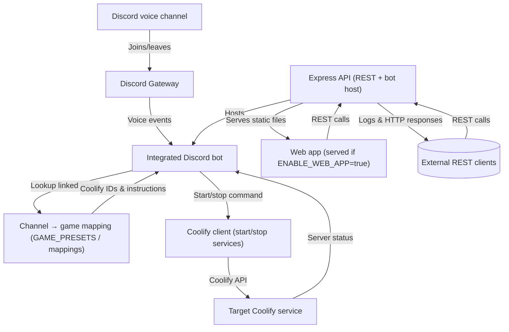

# Coolify_UI_API

This repository provides a minimal structure to control multiple game servers via Coolify with three complementary building blocks:

1. **Web app**: a static page to connect with Google (to be wired), choose a game, and administer the game list.
2. **REST API**: an Express service that manages a game catalog and relays start/stop commands to the Coolify API per game.
3. **Integrated Discord bot**: a bot embedded in the API that starts the server linked to a voice channel when a player joins and triggers shutdown 10 minutes after the last player leaves.

## Project structure

```
app/
  web-app/             # Static interface served by Express
    index.html         # Control + administration
    js/app.js          # REST calls to the API
    styles/main.css    # Base styles
  src/app.js           # Express server and REST routing
  src/routes/          # REST routes (start/stop + games + Discord status)
  src/services/        # Coolify client, in-memory game storage, and integrated Discord bot
  src/services/discordBotService.js # Integrated Discord bot logic
  .env.example         # Expected environment variables
  package.json         # Dependencies and scripts
.github/workflows/
  publish-api-docker.yml # Automatic build and publication of the API Docker image
```

## Prerequisites

- Node.js 18+
- A Coolify account with an API token, the service identifier per game, and the corresponding API URL.
- For the bot: a Discord bot with the Guilds and GuildVoiceStates intents enabled, along with the IDs of the targeted voice channels.
- For the web app: a Google OAuth client (to connect the login button).

## Configuration

1. **REST API + integrated Discord bot + web app**
   - Copy `app/.env.example` to `app/.env`.
   - Fill in the Coolify variables (`COOLIFY_BASE_URL`, `COOLIFY_TOKEN`, `GAME_PRESETS`). To persist the mapping outside the container, point `GAME_PRESETS_FILE` to a mounted JSON file.
   - Control the static site with `ENABLE_WEB_APP` (`true` by default) and, if needed, override its path with `WEB_APP_PATH`.
   - Configure Google Identity by setting `GOOGLE_CLIENT_ID`, `GOOGLE_CLIENT_SECRET`, and `GOOGLE_REDIRECT_URI`, then point `ALLOWED_EMAILS_FILE` to a mounted text file that lists the authorized addresses (one per line). The API will refuse authentication if any value is missing. In the Google Cloud console, set the authorized JavaScript origin to the public URL of your deployment (for local use `http://localhost`) and the authorized redirect URL to the same origin (for example `http://localhost`) so the OAuth code flow can return to the page.
   - Enable the Discord bot by adding `DISCORD_TOKEN` and placing the voice channel IDs directly in `GAME_PRESETS` via `discordVoiceChannelIds` (recommended). Add Discord instructions in the same place with an `instructions` field per game to display guidance at startup. Alternatively, use the `DISCORD_DEFAULT_GAME_ID` + `DISCORD_VOICE_CHANNEL_ID` pair or `DISCORD_GAME_CHANNEL_MAPPINGS` (`[{"channelId":"...","gameId":"...","instructions":"..."}]`). Add per-game instructions via `instructions` in the mappings or with `DISCORD_GAME_INSTRUCTION_MAPPINGS` (JSON `{ "game-id":"instructions" }` or array of objects `{ gameId, instructions }`).
   - Available endpoints:
     - `GET /api/games` to list games.
     - `POST /api/games` to add a game.
     - `PUT /api/games/:id` to update a game.
     - `DELETE /api/games/:id` to delete a game.
     - `POST /api/server/:id/start` and `POST /api/server/:id/stop` to control a game.
     - `GET /api/discord/status` to verify the status of the integrated Discord bot.

2. **Web app**
   - Serve `app/web-app` via the API (root `/` by default) or open `app/web-app/index.html` directly in a browser.
   - Wire the Google Identity SDK to the `#google-login` button if needed.
   - Ensure the REST API is accessible at the configured URL (default `http://localhost`).
   - Use the "Administration des jeux" tab to add/edit/delete games, then the selector to start/stop a server.

## Quick start

Install the API dependencies (the Discord bot is included) and then run it.

```bash
# REST API + web app + integrated Discord bot
cd app
npm install
npm run start
```

The web app is served by the API at the root `/`. If `DISCORD_TOKEN` is present, the bot initializes on startup to listen to the configured voice channels. You can also test the web app directly with `npx serve app/web-app` if needed.

## Single container Web + API

A root `Dockerfile` packages the static web app and the Express API into a single image. The web app is served by Express at the root `/`, and all sensitive values (tokens, Coolify identifiers) are passed through environment variables.

### Example with Docker Compose

A `docker-compose.example.yml` file is provided to run everything locally:

```bash
docker compose -f docker-compose.example.yml up -d
```

Key points of the example:

- The container exposes the default HTTP port (`80`) for the API and the web app.
- The example pulls the published image from Docker Hub (`monolithoid/coolify-api:latest`) instead of building locally.
- Coolify tokens and identifiers are provided via `COOLIFY_TOKEN`, `COOLIFY_PROJECT_ID`, `COOLIFY_SERVICE_ID`, and, if needed, `GAME_PRESETS` to preload games.
- Discord variables (`DISCORD_TOKEN` and the channels defined in `GAME_PRESETS` via `discordVoiceChannelIds`, or failing that `DISCORD_DEFAULT_GAME_ID`, `DISCORD_VOICE_CHANNEL_ID`, or `DISCORD_GAME_CHANNEL_MAPPINGS`) are declared on the same container to enable the integrated bot. Provide `instructions` in each `GAME_PRESETS` entry, in the mappings, or `DISCORD_GAME_INSTRUCTION_MAPPINGS` to send game-specific guidance at startup.
- The delay before automatically stopping the server is configurable via `SERVER_STOP_DELAY_SECONDS` (in seconds, 600 by default).
- Google Identity authentication is wired through `GOOGLE_CLIENT_ID`, `GOOGLE_CLIENT_SECRET`, and `GOOGLE_REDIRECT_URI`, with the allowlist loaded from `ALLOWED_EMAILS_FILE`. These values are set in the Compose example, with `./data/allowed-emails.txt` bind-mounted to `/data/allowed-emails.txt` for persistence. The server exchanges the Google OAuth authorization code using the client secret; keep this secret out of the image by injecting it via environment variables (for example in `docker-compose.example.yml` or a `.env` file).
- Edit the values directly in the Compose file or use a `.env` file loaded by Docker Compose to override them.
- To make the `GAME_PRESETS` mapping persistent, bind-mount a JSON file (for example `./data/game-presets.json`) and set `GAME_PRESETS_FILE` to the in-container path of that file. The API will load the presets from this file on startup and will now write any changes made through the web app or API back to this file.

Once started, go to `http://localhost` to use the web interface (if enabled) and test API calls on the same container.

## Suggested extensions

- Replace the login alert with actual Google Identity Services integration.
- Add state persistence (server status) in the API and expose it to the web app.
- Secure the API (authentication middleware, input validation, rate limiting).
- Add structured logs and telemetry to track command usage.
- Plug in a database to persist the games administered through the web app.

## Architecture: from Discord voice channel to Coolify service



The integrated bot listens for voice events from the configured Discord channel, maps the channel to a game via `GAME_PRESETS` or the Discord mappings, then calls the Coolify client to start or stop the target service. Game-specific instructions are pulled from the same mappings, ensuring a direct link between Discord and the corresponding Coolify service.

## Web + API Docker image

The monolithic image (Express API + static web app) is automatically published to Docker Hub when you push to `main` (workflow `publish-api-docker.yml`). Configure the GitHub secrets `DOCKERHUB_USERNAME` and `DOCKERHUB_TOKEN` to allow publication.

### Build and run locally

```bash
# From the repository root
docker build -t coolify-api-local .
docker run --env-file app/.env -p 80:80 coolify-api-local
```

The image exposes the default HTTP port (`80`) and reads the environment variables described in `app/.env.example` for the API and the web app.
